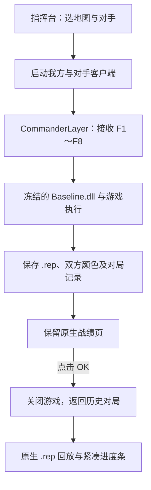

# 星际指挥台 Demo

本地 Windows《星际争霸：母巢之战》人工指挥入口的精简源码与演示流程。

**流程：选择地图和对手 → 开始单局对战 → F1～F8 指挥 → 查看战绩 → 点击 OK 返回 → 从历史对局播放 `.rep`。**

此仓库包含界面、对局启动、人工指挥层、原生回放控制和战绩页关闭逻辑。游戏本体、地图文件、冻结基线、对手机器人包、第三方依赖和个人对局记录需在本机另外准备；下载源码后不能直接开始游戏。

## 演示步骤

1. 在已有完整环境的电脑上打开“星际指挥台”。
2. 分别选择地图、对手，选择“八键人工指挥”和全屏，点击“开始对战”。
3. 在游戏中使用 F1～F8 发布战术指令；用鼠标或方向键移动镜头。
4. 自然结束对局，或按 F10 → End Mission → Surrender 并确认。战绩页保留，录像先保存。
5. 查看统计后点击 **OK**，游戏关闭并返回指挥台；不会自动开始下一局。
6. 进入“历史对局 / 回放”，双击记录或点击“播放 .rep”。可以暂停、变速和拖动进度条。

更完整的操作说明见 [使用说明](使用说明.md)，环境准备见 [本地运行](docs/LOCAL_SETUP.md)。

## 八键人工指挥

| 按键 | 指令 | 主要行为 |
| --- | --- | --- |
| F1 | 侦察 | 派合适单位侦察，不改变主力指令 |
| F2 | 小队骚扰 | 保留主力，派少量健康单位骚扰 |
| F3 | 攻敌方分矿 | 优先已发现的分基地；未知时先侦察 |
| F4 | 就地固守 | 以当前位置为防区，限制追击范围 |
| F5 | 攻主基地 | 推进敌方主基地，减少被侦察探机牵走 |
| F6 | 保卫基地 | 返回受威胁的己方基地防守 |
| F7 | 就地集结 | 在附近收拢部队，等待下一步指令 |
| F8 | 脱战后撤 | 选择附近安全位置，脱战后集结 |

F9 无自定义指令，F10 保留游戏菜单。人工移动镜头优先，空闲十秒后恢复自动镜头。

## 地图与对手

三张地图：Benzene、Heartbreak Ridge、Destination。

十个对手：Stardust-SourceRepairCandidate、PurpleWave、BananaBrain、Locutus、tscmoo-AuthorCandidate、Steamhammer、McRave、HladHammer、PylonPuller、Skynet。

这些名称对应本地留存的固定版本，不能等同于各项目最新版本；Stardust 和 tscmoo 的候选版本身份保留在名称及清单中。文件哈希见 [对手清单](opponents/recorded-roster.json)。

## 原始基线与人工指挥层

原始基线为 **`v6-fix-r1-20261110`**，源码与 DLL 的 SHA256 见 [基线清单](baseline/manifest.json)。原始基线不随 demo 分发，且未改动。`CommanderLayer.dll` 独立加载 `Baseline.dll`，负责人工指令、镜头和对局事件；原有基线继续负责经济和底层行为。

## 源码入口

| 文件 | 作用 |
| --- | --- |
| `app/desktop.pyw` | 地图/对手选择、对局和回放入口 |
| `app/matches.py` | 文件校验、单局启动、录像保存及进程清理 |
| `app/CommanderLayer.cpp` | 人工指挥层、镜头控制、原始基线代理 |
| `app/CommanderRules.h` | 工人诱导、追击及后撤相关规则 |
| `app/native_replay.py`、`app/ReplayControl.cpp` | 原生回放、暂停、变速、进度控制 |
| `app/replay_info.py`、`app/MatchIdentity.h` | 地图、双方颜色与机器人信息 |
| `app/ResultsWatcher.cpp` | 识别战绩页 OK 后的菜单状态，通知指挥台关闭本局 |
| `app/LegacyStorm.*` | 旧版对手的兼容适配 |

## 当前限制

- 仅面向 Windows 与现有 StarCraft 1.16.1 / BWAPI 环境；战绩状态检测使用该游戏版本的固定地址。
- `.rep` 回放通过原版游戏打开；向后拖动会重新载入并快速推进。没有 MP4 功能。
- 历史短测为 30 种组合中 28 种通过；PurpleWave / Heartbreak Ridge、Skynet / Destination 曾开局退出或超时。见 [兼容性记录](validation/compatibility.json)。
- 本次上传只整理 demo，不自动启动对战。源码内保留本地环境的默认路径，可按运行说明覆盖。

游戏、BWAPI、BWEM、cnc-ddraw 及第三方 bot 的权利与许可分别属于原项目；仓库未附带这些第三方文件。
